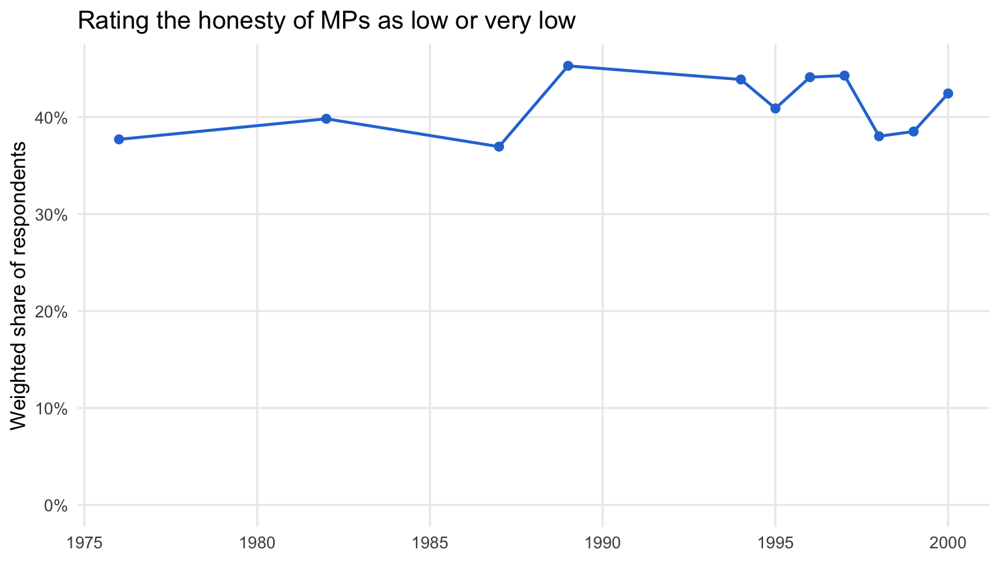
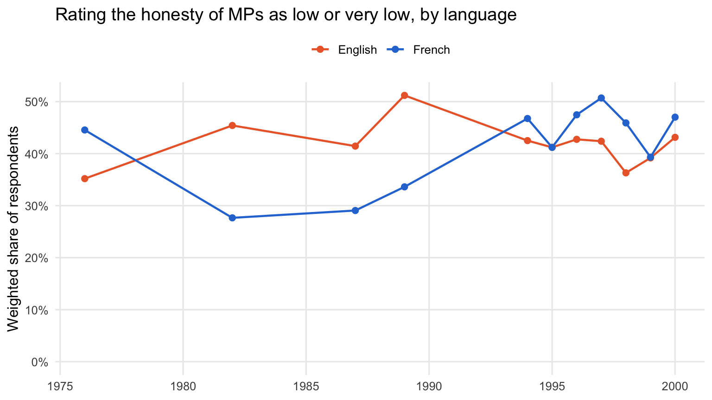

**Download the code:** [adding-variables.R](adding-variables.R) contains all of the R code from this tutorial.

**Using an AI assistant?** [AGENTS.md](AGENTS.md) contains instructions for AI coding assistants such as Claude Code and Codex. Save it in your project folder. Codex reads it automatically; for Claude Code, rename it `CLAUDE.md`, or ask Claude to read it. It tells the assistant how CVPA's IDs work, and to check with you before making substantive choices, such as how to recode a question.

The CVPA dataset harmonizes more than 600 policy questions, but the surveys it draws on include many questions beyond those included in the harmonized dataset. We've designed the CVPA dataset to make it as easy as possible for you to add a question to our data: you simply need to download the original survey files, pull out the new question you're interested in, and link it to the CPVA "backbone" database. Once it's linked, you can analyze your new question alongside everything CVPA already provides: harmonized demographics, vote intention, and the other policy questions.

This tutorial walks through a complete example. We start by adding a question from a single Gallup survey, then show how to add the same question from several surveys at once.

## How respondents are identified

Every row in the CVPA dataset has a `response_id`. The `response_id` isn't an arbitrary number. It's built from two things anyone can see in the original data:

1.  the name of the original survey file, without its extension, and
2.  the respondent's row number in that file, padded to five digits.

The first respondent in the file is row 1. For example, the seventh respondent in Gallup's September 1994 survey (the file `cipo-E-1994-09_F1.sav`) has the ID:

    cipo-E-1994-09_F1_00007

Using this rule, you can rebuild the ID for every respondent in any original file the dataset uses, and then join on it.

To find out which file a CVPA respondent came from, drop the underscore and row number from the end of their `response_id`. Don't rely on the `survey_id` column for this. For Gallup surveys it's the file name, but for the Canadian Election Study and Democracy Checkup it's a shorter label, such as `2006.dta`.

## Worked example: honesty of Members of Parliament

Gallup periodically asked Canadians to rate the honesty and ethical standards of people in different occupations, including Members of Parliament. The question isn't in CVPA, but Gallup asked it in eleven surveys between 1976 and 2000. We'll start with just one of them: Gallup's March 2000 survey, the file `cipo-E-2000-03_F1.sav`, where the question is stored in a variable called `mp`.

Finding the right variable in a file means reading the survey documentation or the variable labels. That's usually the most time-consuming step.

## Step 1: Load packages

We'll use `tidyverse` for data handling, `haven` to read the SPSS files, and `nanoparquet` to read the CVPA dataset:

``` r
library(tidyverse)
library(haven)
library(nanoparquet)

# The downloads below can take more than R's default of 60 seconds
options(timeout = 600)
```

## Step 2: Download the original survey

The Gallup surveys are archived on [Borealis](https://borealisdata.ca/), the Canadian research data repository, where anyone can download them. Each survey has its own Borealis entry; the March 2000 survey is [doi:10.5683/SP2/J7YW6U](https://doi.org/10.5683/SP2/J7YW6U). You can download the file from that page, or directly in R using its Borealis file ID, 81942:

``` r
download.file(
  "https://borealisdata.ca/api/access/datafile/81942?format=original",
  "cipo-E-2000-03_F1.sav", mode = "wb"
)
```

**Save the file under its original name**, because the name is part of every respondent's ID. The `?format=original` at the end of the address asks Borealis for the original SPSS file, rather than the tab-delimited version it also stores.

## Step 3: Read the file and check the codes

``` r
gallup_2000 <- read_sav("cipo-E-2000-03_F1.sav", user_na = TRUE)
```

We read the file with `user_na = TRUE`. By default, `read_sav()` silently converts any code the SPSS file declares as missing to `NA`. That's convenient, but it hides codes we want to see.

Before recoding anything, look at how the question is coded. `print_labels()` shows the codes and their labels, and `count()` shows how many respondents gave each one:

``` r
print_labels(gallup_2000$mp)
```


    Labels:
     value      label
         1  VERY HIGH
         2       HIGH
         3    AVERAGE
         4        LOW
         5   VERY LOW
         6 DON'T KNOW
         7    REFUSED

``` r
gallup_2000 %>%
  count(mp = as.numeric(mp))
```

    # A tibble: 7 × 2
         mp     n
      <dbl> <int>
    1     1    19
    2     2    95
    3     3   445
    4     4   277
    5     5   133
    6     6    31
    7     7     2

Codes 1 to 5 are the ratings, from very high to very low. Code 6 is "don't know" and 7 is "refused," so we'll treat those as missing.

## Step 4: Build the IDs and recode

Now add a `response_id` to every row, recode the rating, and keep the survey's weight variable, `wtvar`:

``` r
mp_2000 <- gallup_2000 %>%
  mutate(
    response_id = paste0("cipo-E-2000-03_F1_", str_pad(row_number(), 5, pad = "0")),
    mp_rating = if_else(as.numeric(mp) %in% 1:5, as.numeric(mp), NA),
    weight = as.numeric(wtvar)
  ) %>%
  select(response_id, mp_rating, weight)

mp_2000
```

    # A tibble: 1,002 × 3
       response_id             mp_rating weight
       <chr>                       <dbl>  <dbl>
     1 cipo-E-2000-03_F1_00001         3  0.969
     2 cipo-E-2000-03_F1_00002         3  1.13 
     3 cipo-E-2000-03_F1_00003         2  0.976
     4 cipo-E-2000-03_F1_00004         1  1.13 
     5 cipo-E-2000-03_F1_00005         3  0.976
     6 cipo-E-2000-03_F1_00006         3  0.902
     7 cipo-E-2000-03_F1_00007         4  0.902
     8 cipo-E-2000-03_F1_00008         5  1.03 
     9 cipo-E-2000-03_F1_00009         3  0.969
    10 cipo-E-2000-03_F1_00010         3  0.969
    # ℹ 992 more rows

The `response_id` line is the whole of the ID rule: the file name without `.sav`, an underscore, and the row number padded to five digits.

**Never filter or sort the rows before numbering them.** The ID is the row's position in the original file. If you drop or reorder rows before calling `row_number()`, every respondent after that point gets someone else's ID -- a big problem for your analysis!

## Step 5: Join to the CVPA dataset

Download the CVPA dataset from [our GitHub repository](https://github.com/lucasjacklucas/cvpa_dataset). The dataset has one row for every answer, so a respondent appears once for each question they answered. We only need one row per respondent, with the demographics we want to use:

``` r
download.file(
  "https://github.com/lucasjacklucas/cvpa_dataset/raw/main/dataset.parquet",
  "dataset.parquet", mode = "wb"
)

respondents <- read_parquet(
  "dataset.parquet",
  col_select = c("response_id", "year", "gender", "age_cats", "degree", "language")
) %>%
  distinct(response_id, .keep_all = TRUE)
```

Now join the new variable to the CVPA respondents:

``` r
linked_2000 <- mp_2000 %>%
  left_join(respondents, by = "response_id")
```

Check that every respondent in the Gallup file found a match. If the IDs were built correctly, this is zero:

``` r
sum(is.na(linked_2000$year))
```

    [1] 0

If it isn't zero, the most likely causes are a file saved under a different name, or rows that were dropped or reordered before numbering.

## Step 6: Analyze

The new variable now sits alongside CVPA's harmonized demographics. Here is the weighted share of respondents who rated the honesty of MPs as low or very low (codes 4 and 5):

``` r
linked_2000 %>%
  filter(!is.na(mp_rating)) %>%
  summarise(low_share = weighted.mean(mp_rating >= 4, weight))
```

    # A tibble: 1 × 1
      low_share
          <dbl>
    1     0.424

And here it is broken down by language. In `dataset.parquet` the demographics are stored as numeric codes; the [codebook](https://github.com/lucasjacklucas/cvpa_dataset/blob/main/Codebook%20and%20Documentation.md) lists what each code means. For language, 1 is French and 2 is English:

``` r
linked_2000 %>%
  filter(!is.na(mp_rating), language %in% 1:2) %>%
  mutate(language = if_else(language == 1, "French", "English")) %>%
  group_by(language) %>%
  summarise(low_share = weighted.mean(mp_rating >= 4, weight), respondents = n())
```

    # A tibble: 2 × 3
      language low_share respondents
      <chr>        <dbl>       <int>
    1 English      0.431         586
    2 French       0.470         255

## Adding the question from several surveys

Gallup asked the same question in ten other surveys. Here are all eleven, with the variable that holds the question in each and its Borealis file ID:

| survey file                   | variable | year | file ID |
|-------------------------------|----------|------|---------|
| `cipo-391-E-1976-08_F1.sav`   | `q2i`    | 1976 | 82679   |
| `cipo-464-1-E-1982-08_F1.sav` | `q4i`    | 1982 | 82938   |
| `cipo-526-1-E-1987-10_F1.sav` | `q10i`   | 1987 | 83154   |
| `cipo-910-1-E-1989-10_F1.sav` | `qq14i`  | 1989 | 83250   |
| `cipo-E-1994-09_F1.sav`       | `q5#i`   | 1994 | 83456   |
| `cipo-E-1995-03_F1.sav`       | `q6_i`   | 1995 | 83474   |
| `cipo-E-1996-03_F1.sav`       | `hmop`   | 1996 | 83508   |
| `cipo-E-1997-03_F1.sav`       | `mop`    | 1997 | 83546   |
| `cipo-E-1998-03_F1.sav`       | `q8i`    | 1998 | 83584   |
| `cipo-E-1999-03_F1.sav`       | `q6i`    | 1999 | 83620   |
| `cipo-E-2000-03_F1.sav`       | `mp`     | 2000 | 81942   |

This is realistic, because the question is stored differently in every survey. The variable name changes each time, and the 1994 and 1995 surveys ask about "ethical standards" rather than "honesty." The process is the same as for one file, repeated for each survey, so we put the file names, variables, and IDs in a table and loop over it:

``` r
mp_files <- tribble(
  ~file,                         ~var,    ~file_id,
  "cipo-391-E-1976-08_F1.sav",   "q2i",   82679,
  "cipo-464-1-E-1982-08_F1.sav", "q4i",   82938,
  "cipo-526-1-E-1987-10_F1.sav", "q10i",  83154,
  "cipo-910-1-E-1989-10_F1.sav", "qq14i", 83250,
  "cipo-E-1994-09_F1.sav",       "q5#i",  83456,
  "cipo-E-1995-03_F1.sav",       "q6_i",  83474,
  "cipo-E-1996-03_F1.sav",       "hmop",  83508,
  "cipo-E-1997-03_F1.sav",       "mop",   83546,
  "cipo-E-1998-03_F1.sav",       "q8i",   83584,
  "cipo-E-1999-03_F1.sav",       "q6i",   83620,
  "cipo-E-2000-03_F1.sav",       "mp",    81942
)

for (i in seq_len(nrow(mp_files))) {
  if (!file.exists(mp_files$file[i])) {
    download.file(
      paste0("https://borealisdata.ca/api/access/datafile/",
             mp_files$file_id[i], "?format=original"),
      mp_files$file[i], mode = "wb"
    )
  }
}
```

### Check the codes in every file

As in Step 3, check the codes before recoding. Here are all the values outside 1--5 in each file:

``` r
raw_codes <- map2_dfr(mp_files$file, mp_files$var, function(file, var) {
  raw <- read_sav(file, user_na = TRUE)
  tibble(file = file, code = as.numeric(raw[[var]]))
})

raw_codes %>%
  filter(!code %in% 1:5) %>%
  count(file, code)
```

    # A tibble: 19 × 3
       file                         code     n
       <chr>                       <dbl> <int>
     1 cipo-391-E-1976-08_F1.sav       6    27
     2 cipo-464-1-E-1982-08_F1.sav     6    13
     3 cipo-526-1-E-1987-10_F1.sav    11    47
     4 cipo-526-1-E-1987-10_F1.sav    99     1
     5 cipo-910-1-E-1989-10_F1.sav    11    32
     6 cipo-910-1-E-1989-10_F1.sav    12     2
     7 cipo-E-1994-09_F1.sav           6    53
     8 cipo-E-1995-03_F1.sav           6    49
     9 cipo-E-1995-03_F1.sav           7     2
    10 cipo-E-1996-03_F1.sav           6    45
    11 cipo-E-1996-03_F1.sav           7     3
    12 cipo-E-1997-03_F1.sav           6    51
    13 cipo-E-1997-03_F1.sav           7     4
    14 cipo-E-1998-03_F1.sav           6    43
    15 cipo-E-1998-03_F1.sav           7     1
    16 cipo-E-1999-03_F1.sav           6    34
    17 cipo-E-1999-03_F1.sav           7     3
    18 cipo-E-2000-03_F1.sav           6    31
    19 cipo-E-2000-03_F1.sav           7     2

The codes for respondents who didn't give a rating vary from survey to survey:

- Code 6 means "not stated" in 1976 and 1982, but "don't know" from 1994 onward.
- The 1987 and 1989 surveys use 11 for not stated or don't know, and 99 for blanks.
- The 1989 file contains a code 12 that doesn't appear in its value labels at all. Always check the actual values, not just the labels.

The five ratings, though, use the same codes (1 to 5) in every survey. So the rule from Step 4 works for all eleven: keep codes 1 to 5, and treat everything else as missing. With other questions you may need a different rule for each survey.

### Build the IDs for every file

We turn Step 4 into a function that takes a file name and a variable name, and apply it to each survey. The only other change is the weight: the 1976 file has no weight variable, so its respondents get a weight of 1.

``` r
build_mp <- function(file, var) {
  read_sav(file, user_na = TRUE) %>%
    mutate(
      response_id = paste0(tools::file_path_sans_ext(file), "_",
                           str_pad(row_number(), 5, pad = "0")),
      mp_rating = if_else(as.numeric(.data[[var]]) %in% 1:5, as.numeric(.data[[var]]), NA),
      weight = if ("wtvar" %in% names(.)) as.numeric(wtvar) else 1
    ) %>%
    select(response_id, mp_rating, weight)
}

mp_honesty <- map2_dfr(mp_files$file, mp_files$var, build_mp)
```

`tools::file_path_sans_ext()` drops the `.sav` from each file name, so the IDs are built exactly as in Step 4.

### Join and analyze

Join to the CVPA respondents and check the match, as before:

``` r
linked <- mp_honesty %>%
  left_join(respondents, by = "response_id")

sum(is.na(linked$year))
```

    [1] 0

Now we can follow the question over time:

``` r
mp_by_year <- linked %>%
  filter(!is.na(mp_rating)) %>%
  group_by(year) %>%
  summarise(low_share = weighted.mean(mp_rating >= 4, weight))

mp_by_year
```

    # A tibble: 11 × 2
        year low_share
       <dbl>     <dbl>
     1  1976     0.377
     2  1982     0.398
     3  1987     0.370
     4  1989     0.453
     5  1994     0.439
     6  1995     0.409
     7  1996     0.441
     8  1997     0.443
     9  1998     0.380
    10  1999     0.385
    11  2000     0.424

``` r
ggplot(mp_by_year, aes(x = year, y = low_share)) +
  geom_line(linewidth = 0.8, colour = "#2a78d6") +
  geom_point(size = 2, colour = "#2a78d6") +
  scale_y_continuous(labels = scales::percent, limits = c(0, NA)) +
  labs(
    title = "Rating the honesty of MPs as low or very low",
    x = NULL, y = "Weighted share of respondents"
  ) +
  theme_minimal(base_size = 12) +
  theme(panel.grid.minor = element_blank())
```



And break it down by language over time:

``` r
mp_by_language <- linked %>%
  filter(!is.na(mp_rating), language %in% 1:2) %>%
  mutate(language = if_else(language == 1, "French", "English")) %>%
  group_by(year, language) %>%
  summarise(low_share = weighted.mean(mp_rating >= 4, weight), .groups = "drop")
```

``` r
language_colours <- c("French" = "#2a78d6", "English" = "#eb6834")

ggplot(mp_by_language, aes(x = year, y = low_share, colour = language)) +
  geom_line(linewidth = 0.8) +
  geom_point(size = 2) +
  scale_colour_manual(values = language_colours) +
  scale_y_continuous(labels = scales::percent, limits = c(0, NA)) +
  labs(
    title = "Rating the honesty of MPs as low or very low, by language",
    x = NULL, y = "Weighted share of respondents", colour = NULL
  ) +
  theme_minimal(base_size = 12) +
  theme(legend.position = "top", panel.grid.minor = element_blank())
```



## Next steps

- The same approach works for other surveys in CVPA. Find the file name from the `response_id`, download the original file, and build the IDs the same way. Most of the surveys are publicly archived, including every Gallup survey. The exceptions are the Pollara surveys, which are restricted, and the 2026 Bridge Survey, which isn't publicly archived yet. (Our repository includes a minimal version of the Bridge Survey, but it contains only the variables already in CVPA.)
- Some original files contain rows that aren't in CVPA, so the check in Step 5 won't always come to zero. For those files, check the match from the other direction: every CVPA respondent from that survey should find a row in your file. The Canadian Election Study panel files, covered in the next section, are the main example.
- You can also join your new variable to CVPA's policy questions and vote intention, as long as they were asked in the same surveys. Filter `dataset.parquet` to the `question_id` you want, and join on `response_id`.
- If you add a question that you think others would find useful, let us know. We may be able to include it in a future release of the dataset.

## Special case: Canadian Election Study panels

Two Canadian Election Study files are panel studies, in which some of the same people were interviewed in several election years. Each panel is a single file on Borealis that holds every wave:

| panel | Borealis entry | file to use | waves in CVPA |
|------------------|------------------|------------------|------------------|
| 1974--1979--1980 | [doi:10.5683/SP3/RBKRTJ](https://doi.org/10.5683/SP3/RBKRTJ) | `CES-E-1974-1980_F1.dta` | 1974, 1979, 1980 |
| 2004--2006--2008 | [doi:10.5683/SP3/SSYLQH](https://doi.org/10.5683/SP3/SSYLQH) | `ces2004-6-8.dta` | 2004, 2006, 2008 |

CVPA treats each wave as a separate survey, so the IDs for these files work a little differently:

- **The wave is added to the file name.** A respondent's ID in the 2006 wave starts with `ces2004-6-8_2006wave_`, not `ces2004-6-8_`. There is no file called `ces2004-6-8_2006wave.dta` to download: you download the single panel file and add the wave yourself.
- **The row number comes from the full panel file.** Someone interviewed in 2004 and 2006 has two IDs, `ces2004-6-8_2004wave_00123` and `ces2004-6-8_2006wave_00123`, with the same row number. That row number is also how you follow the same person across waves.
- **Not every row is in every wave.** The 2004--2008 file has 9,639 rows, but only about 4,000 of them are in any one wave. The rest are people who weren't interviewed in that wave. So most rows of the file won't match a given wave, and the check in Step 5 doesn't apply. Check instead that every CVPA respondent in the wave found a row in your file.

### One wave

As an example, we'll add satisfaction with the way democracy works in Canada, which isn't in CVPA, starting with the 2006 wave. The panel file comes inside a zip file. The zip contains two versions of the data: use `ces2004-6-8.dta`, which is the version CVPA was built from. (The other version, `CES-E-2004-2008_F1.dta`, has its rows in the same order but codes some missing values differently.)

``` r
download.file("https://borealisdata.ca/api/access/datafile/880910",
              "ces2004-6-8_STATA.zip", mode = "wb")
unzip("ces2004-6-8_STATA.zip", files = "ces2004-6-8.dta")

panel <- read_dta("ces2004-6-8.dta")
nrow(panel)
```

    [1] 9639

The question was asked in both the campaign-period survey and the post-election survey. We use the post-election version. In 2006 that's `ces06_pes_a1`:

``` r
print_labels(panel$ces06_pes_a1)
```


    Labels:
     value                label
         1       very satisfied
         3     fairly satisfied
         5   not very satisfied
         7 not satisfied at all
         8           don't know
         9              refused

Codes 1 and 3 are satisfied, 5 and 7 are not satisfied, and 8 and 9 are don't know and refused. We build the IDs exactly as before, except that the wave goes after the file name:

``` r
swd_2006 <- panel %>%
  mutate(
    response_id = paste0("ces2004-6-8_2006wave_", str_pad(row_number(), 5, pad = "0")),
    satisfied = case_when(
      as.numeric(ces06_pes_a1) %in% c(1, 3) ~ 1,
      as.numeric(ces06_pes_a1) %in% c(5, 7) ~ 0
    )
  ) %>%
  select(response_id, satisfied)
```

This time we check the match from the CVPA side. Every CVPA respondent in the 2006 wave should find a row in `swd_2006`, so this is zero:

``` r
respondents_2006 <- respondents %>%
  filter(str_starts(response_id, "ces2004-6-8_2006wave_"))

sum(!respondents_2006$response_id %in% swd_2006$response_id)
```

    [1] 0

For the same reason, we join in that direction too, starting from the CVPA respondents:

``` r
linked_2006 <- respondents_2006 %>%
  left_join(swd_2006, by = "response_id")

linked_2006 %>%
  summarise(respondents = n(), answered = sum(!is.na(satisfied)))
```

    # A tibble: 1 × 2
      respondents answered
            <int>    <int>
    1        4058     3157

Not everyone in the wave answered this question. Some respondents took part only in the campaign-period survey, so they were never asked the post-election version. They're in CVPA, but their `satisfied` value is `NA`. (So are respondents who said they didn't know or refused.)

### All three waves

The question has a different variable name in each wave, but the same codes. We put the waves and variables in a table, and turn the 2006 code into a function that takes a wave and a variable. We also keep the row number, so we can follow respondents across waves:

``` r
swd_vars <- tribble(
  ~wave, ~var,
  2004,  "ces04_pes_a11",
  2006,  "ces06_pes_a1",
  2008,  "ces08_pes_a1"
)

build_swd <- function(wave, var) {
  panel %>%
    mutate(
      row = str_pad(row_number(), 5, pad = "0"),
      response_id = paste0("ces2004-6-8_", wave, "wave_", row),
      wave = wave,
      satisfied = case_when(
        as.numeric(.data[[var]]) %in% c(1, 3) ~ 1,
        as.numeric(.data[[var]]) %in% c(5, 7) ~ 0
      )
    ) %>%
    select(response_id, row, wave, satisfied)
}

swd <- map2_dfr(swd_vars$wave, swd_vars$var, build_swd)
```

We use the post-election version of the question in every wave for a reason. In 2008, the returning panel respondents took part only in the post-election survey, so the campaign version (`ces08_cps_a1`) was never asked of them. The variable `survey_type040608` records which parts of the study each respondent completed, and is worth checking before you choose a variable from a panel file.

Check the match and join, as for the single wave:

``` r
panel_respondents <- respondents %>%
  filter(str_starts(response_id, "ces2004-6-8_"))

sum(!panel_respondents$response_id %in% swd$response_id)
```

    [1] 0

``` r
panel_linked <- panel_respondents %>%
  left_join(swd, by = "response_id")
```

Because the row number identifies the same person in every wave, we can count how many respondents answered the question in one, two, or all three waves:

``` r
panel_linked %>%
  filter(!is.na(satisfied)) %>%
  count(row, name = "waves_answered") %>%
  count(waves_answered, name = "respondents")
```

    # A tibble: 3 × 2
      waves_answered respondents
               <int>       <int>
    1              1        5233
    2              2         675
    3              3        1077

To compare the same people's answers across waves, put each wave in its own column with `pivot_wider()`:

``` r
panel_wide <- panel_linked %>%
  filter(!is.na(satisfied)) %>%
  select(row, wave, satisfied) %>%
  pivot_wider(names_from = wave, values_from = satisfied, names_prefix = "satisfied_")

panel_wide
```

    # A tibble: 6,985 × 4
       row   satisfied_2004 satisfied_2006 satisfied_2008
       <chr>          <dbl>          <dbl>          <dbl>
     1 00002              1             NA             NA
     2 00003              1             NA             NA
     3 00004              0             NA             NA
     4 00011              1             NA             NA
     5 00012              1             NA             NA
     6 00019              0             NA             NA
     7 00025              1             NA             NA
     8 00027              0             NA             NA
     9 00028              1             NA             NA
    10 00032              1             NA             NA
    # ℹ 6,975 more rows

The 1974--1980 panel works the same way. Download it from Borealis (file ID 881540), extract `CES-E-1974-1980_F1.dta` from the zip, and build IDs that start with `CES-E-1974-1980_F1_1974wave_`, `CES-E-1974-1980_F1_1979wave_`, or `CES-E-1974-1980_F1_1980wave_`.
