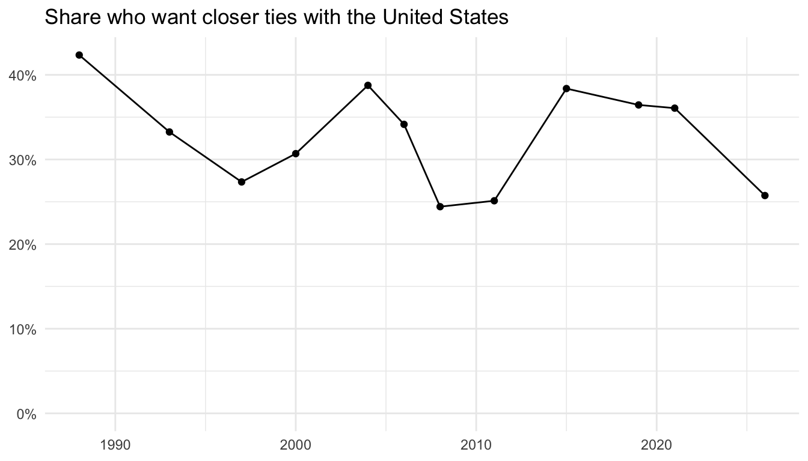

**Download the code:** [raw-data.R](raw-data.R) contains all of the R code from this tutorial.

The full Canadian Voting and Policy Attitudes (CVPA) dataset is a single file, `dataset.parquet`, stored in our [GitHub repository](https://github.com/lucasjacklucas/cvpa_dataset). This tutorial shows how to download that file, open it in R, understand how it is organized, and pull out a single question for analysis.

If you mainly want weighted estimates over time, the [`cvpa` R package]() does all of this for you. The raw file is for when you want to work with the individual responses directly.

## Step 1: Download the file

The dataset is about 14 MB. Download it from the repository, either by visiting the [file's page on GitHub](https://github.com/lucasjacklucas/cvpa_dataset/blob/main/dataset.parquet) and clicking the download button, or directly in R:

``` r
download.file(
  "https://github.com/lucasjacklucas/cvpa_dataset/raw/main/dataset.parquet",
  "dataset.parquet", mode = "wb"
)
```

While you're there, download the question codebook too. It tells you what each question asked and what its response codes mean:

``` r
download.file(
  "https://github.com/lucasjacklucas/cvpa_dataset/raw/main/question_codebook.csv",
  "question_codebook.csv", mode = "wb"
)
```

## Step 2: Open it in R

Parquet is a compressed, column-oriented file format. It is much smaller than a CSV holding the same data and faster to read, but you need a package to open it. We'll use `nanoparquet`, which is small and has no dependencies, along with `tidyverse` for data handling:

``` r
install.packages(c("nanoparquet", "tidyverse"))
```

``` r
library(tidyverse)
library(nanoparquet)

cvpa <- read_parquet("dataset.parquet")
```

The file is small on disk because Parquet compresses repeated values well, but it expands to about 2 GB once loaded in R. Most laptops can handle this. If yours struggles, read only the columns you need with `col_select`, as in the next section.

## Step 3: Look at the data

The dataset has one row for every answer to every question:

``` r
dim(cvpa)
```

    [1] 9198156      28

``` r
head(cvpa)
```

    # A tibble: 6 × 28
      response_id      survey_id source  year start_date end_date date_source gender
      <chr>            <chr>     <chr>  <dbl> <chr>      <chr>    <chr>        <dbl>
    1 bridge_clean_00… bridge_c… CVPA …  2026 2026-01-12 2026-02… recorded         0
    2 bridge_clean_00… bridge_c… CVPA …  2026 2026-01-12 2026-02… recorded         0
    3 bridge_clean_00… bridge_c… CVPA …  2026 2026-01-12 2026-02… recorded         0
    4 bridge_clean_00… bridge_c… CVPA …  2026 2026-01-12 2026-02… recorded         0
    5 bridge_clean_00… bridge_c… CVPA …  2026 2026-01-12 2026-02… recorded         0
    6 bridge_clean_00… bridge_c… CVPA …  2026 2026-01-12 2026-02… recorded         0
    # ℹ 20 more variables: age <dbl>, age_cats <dbl>, region <dbl>, province <dbl>,
    #   com_100 <dbl>, com_500 <dbl>, degree <dbl>, occupation <dbl>,
    #   religion <dbl>, union_household <dbl>, language <dbl>, language_var <dbl>,
    #   language_home <dbl>, mother_tongue <dbl>, survey_mode <dbl>,
    #   policy_domain <chr>, policy_domain_label <chr>, issue_label <chr>,
    #   question_id <chr>, value <dbl>

A respondent appears once for each question they answered, so their demographic values repeat down their rows. Each row carries four things:

|  | columns |
|------------------------------------|------------------------------------|
| respondent and survey | `response_id`, `survey_id`, `source`, `year`, `start_date`, `end_date`, `date_source` |
| demographics | `gender`, `age`, `age_cats`, `region`, `province`, `com_100`, `com_500`, `degree`, `occupation`, `religion`, `union_household`, `language`, `language_var`, `language_home`, `mother_tongue`, `survey_mode` |
| the question | `policy_domain`, `policy_domain_label`, `issue_label`, `question_id` |
| the answer | `value` |

Everything except the identifiers and labels is stored as a numeric code. The [codebook](https://github.com/lucasjacklucas/cvpa_dataset/blob/main/Codebook%20and%20Documentation.md) lists what each code means. For example, `gender` is 0 for men, 1 for women, and 2 for non-binary respondents; `language` is 1 for French and 2 for English.

The data come from five sources spanning 1945 to 2026:

``` r
cvpa %>%
  group_by(source) %>%
  summarise(
    respondents = n_distinct(response_id),
    first_year = min(year),
    last_year = max(year)
  )
```

    # A tibble: 5 × 4
      source                  respondents first_year last_year
      <chr>                         <int>      <dbl>     <dbl>
    1 CVPA 2026 Bridge Survey        7016       2026      2026
    2 Canadian Election Study      168744       1965      2024
    3 Environics                   264710       1978      2012
    4 Gallup                       509303       1945      2000
    5 Pollara                       60231       1992      2002

Vote intention and vote choice are questions here, not columns. They sit in their own policy domain alongside the policy items:

``` r
cvpa %>%
  distinct(policy_domain_label, question_id) %>%
  count(policy_domain_label, sort = TRUE)
```

    # A tibble: 8 × 2
      policy_domain_label                       n
      <chr>                                 <int>
    1 Economy and Taxation                    139
    2 Social Issues, Rights and Justice       123
    3 Immigration, Diversity and Federalism   118
    4 Health, Education and Social Programs    85
    5 Foreign Policy and Identity              73
    6 Energy and Environment                   57
    7 Democracy and Institutions               34
    8 Vote Intention & Choice                   2

## Step 4: Find a question

Each question has a `question_id` and a short `issue_label`. To see the questions in a domain, list the distinct ids. Here are the questions on foreign policy and identity (`"intd"`):

``` r
cvpa %>%
  filter(policy_domain == "intd") %>%
  distinct(question_id, issue_label) %>%
  head(10)
```

    # A tibble: 10 × 2
       question_id  issue_label                          
       <chr>        <chr>                                
     1 bri_intd_002 Canada become part of US             
     2 bri_intd_005 Ties with US closer/more distant     
     3 bri_intd_006 Canada has distinct culture          
     4 bri_intd_007 Support reducing aid to Third World  
     5 bri_intd_008 Keep monarch as head of state        
     6 bri_intd_012 Urban/rural Cdns same values         
     7 bri_intd_001 Compulsory military training at 18   
     8 bri_intd_009 Peacekeeping abroad despite risk     
     9 bri_intd_010 Canada should improve border security
    10 bri_intd_011 Crack down on terrorists vs rights   

The full wording and response categories are in `question_codebook.csv`. It has one row per survey that asked the question, so we keep one row per question. `issue_question_id` in the codebook matches `question_id` in the data:

``` r
codebook <- read_csv("question_codebook.csv", col_types = cols(.default = "c")) %>%
  distinct(issue_question_id, .keep_all = TRUE) %>%
  select(question_id = issue_question_id, question_wording, recode_type, value_labels)

codebook %>%
  filter(question_id == "bri_intd_005") %>%
  glimpse()
```

    Rows: 1
    Columns: 4
    $ question_id      <chr> "bri_intd_005"
    $ question_wording <chr> "Do you think Canada's ties with the United States sh…
    $ recode_type      <chr> "-1/0/1/9999/NA"
    $ value_labels     <chr> "More distant, Same, Closer"

`recode_type` lists the values the question can take and `value_labels` names the substantive ones in ascending order. So for this question, -1 is "More distant", 0 is "Same", and 1 is "Closer". The code `9999` is don't know or no opinion. It is a real answer, distinct from `NA`, and you'll usually want to decide whether to keep it in the denominator.

## Step 5: Pull out one question

Filter the dataset to the question you want. This gives one row per respondent who answered it:

``` r
ties <- cvpa %>%
  filter(question_id == "bri_intd_005")

ties %>%
  count(year, value)
```

    # A tibble: 48 × 3
        year value     n
       <dbl> <dbl> <int>
     1  1988    -1   622
     2  1988     0  1245
     3  1988     1  1371
     4  1988  9999   328
     5  1993    -1   945
     6  1993     0  1223
     7  1993     1  1080
     8  1993  9999   516
     9  1997    -1   532
    10  1997     0  1700
    # ℹ 38 more rows

If memory is tight, you can skip loading the full file and read only the rows and columns you need. `nanoparquet` can select columns, and the filter runs right after:

``` r
ties <- read_parquet(
  "dataset.parquet",
  col_select = c("response_id", "year", "gender", "language", "question_id", "value")
) %>%
  filter(question_id == "bri_intd_005")
```

## Step 6: Summarize it

From here it's ordinary data analysis. Here is the share of respondents in each year who wanted closer ties with the United States, excluding don't knows:

``` r
ties_by_year <- ties %>%
  filter(value != 9999) %>%
  group_by(year) %>%
  summarise(
    closer = mean(value == 1),
    n = n()
  )

ties_by_year
```

    # A tibble: 12 × 3
        year closer     n
       <dbl>  <dbl> <int>
     1  1988  0.423  3238
     2  1993  0.333  3248
     3  1997  0.273  3072
     4  2000  0.307  2786
     5  2004  0.388  4154
     6  2006  0.342  3918
     7  2008  0.244  3595
     8  2011  0.251  3296
     9  2015  0.384  6897
    10  2019  0.364  4961
    11  2021  0.361 14196
    12  2026  0.257  6531

And the same share broken down by language (1 is French, 2 is English):

``` r
ties %>%
  filter(value != 9999, language %in% c(1, 2)) %>%
  mutate(language = if_else(language == 1, "French", "English")) %>%
  group_by(year, language) %>%
  summarise(closer = mean(value == 1), .groups = "drop") %>%
  pivot_wider(names_from = language, values_from = closer)
```

    # A tibble: 12 × 3
        year English French
       <dbl>   <dbl>  <dbl>
     1  1988   0.389  0.533
     2  1993   0.305  0.481
     3  1997   0.239  0.362
     4  2000   0.280  0.360
     5  2004   0.401  0.352
     6  2006   0.339  0.343
     7  2008   0.225  0.293
     8  2011   0.236  0.300
     9  2015   0.364  0.440
    10  2019   0.360  0.405
    11  2021   0.328  0.435
    12  2026   0.246  0.280

``` r
ggplot(ties_by_year, aes(x = year, y = closer)) +
  geom_line() +
  geom_point() +
  scale_y_continuous(labels = scales::percent, limits = c(0, NA)) +
  labs(
    x = NULL, y = NULL,
    title = "Share who want closer ties with the United States"
  ) +
  theme_minimal()
```



These are unweighted shares of the raw responses. The `cvpa` R package computes weighted annual estimates from the same data, so for published figures start with the [package tutorial]().

## Where to go next

- The [codebook](https://github.com/lucasjacklucas/cvpa_dataset/blob/main/Codebook%20and%20Documentation.md) documents every demographic variable, the vote items, and how to read `question_codebook.csv`.
- [Adding Variables from the Original Surveys]() shows how to link a question we don't include to CVPA respondents using `response_id`.
- The [interactive app](https://policyattitudes.ca/app/) lets you explore any question in the dataset without writing code.
