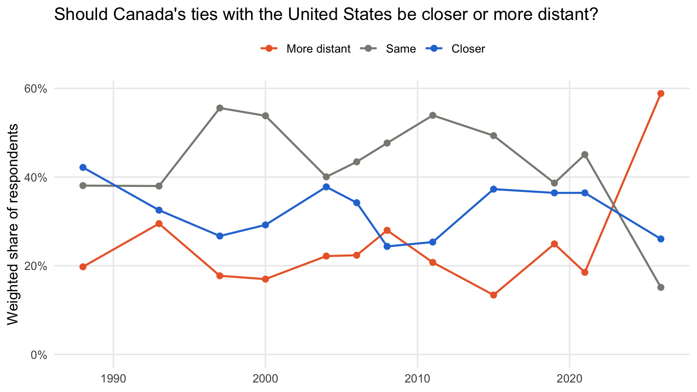
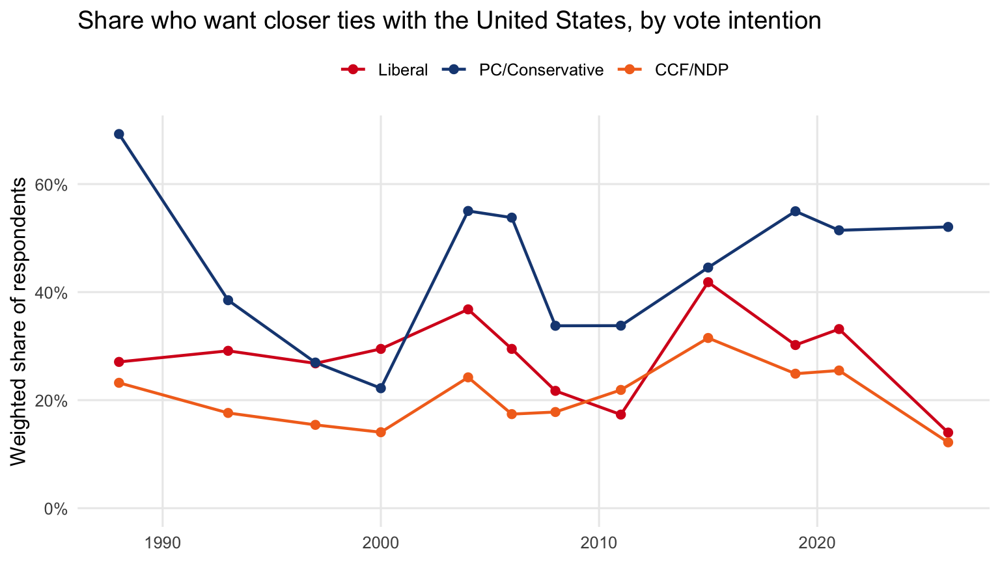

The `cvpa` R package is the easiest way to do data analysis in R using the Canadian Voting and Policy Attitudes (CVPA) dataset. The package downloads the necessary data for you, creates response categories and demographic variables as labelled factors, and computes annually-weighted estimates over time, either for the whole population or broken down by demographic group.

This tutorial provides a basic overview of how to install and load the package, identify a question and download its data, compute weighted responses by year, compute weighted responses by year, broken down by group, and plot the results.

## Installing and loading the package

`cvpa` is hosted on GitHub. Install it with the `remotes` package (you only need to do this once):

``` r
install.packages("remotes")
remotes::install_github("davidaarmstrong/cvpa")
```

Then load it, along with `tidyverse` and `ggplot2`, which we'll use for data handling and plotting:

``` r
library(cvpa)
library(tidyverse)
library(ggplot2)
```

## Finding a question

Next, use `update_cvpa_data()` to download the question catalog (a small file listing every question in the dataset) to a local cache:

``` r
update_cvpa_data(quiet = TRUE)
```

`question_catalog()` returns one row per question, with its code, policy domain, a short label, the full question wording, the response categories, and the number of survey waves that asked it. You can filter it to a single domain. Here we look at questions on international affairs and defence (`"intd"`):

``` r
question_catalog(domain = "intd") %>%
  select(question, issue_label, value_labels, n_waves) %>%
  arrange(desc(n_waves)) %>%
  head(10)
```

           question                          issue_label
    1  env_intd_016        Appr fed govt: defence policy
    2  env_intd_003             Opinion of US favourable
    3  bri_intd_007  Support reducing aid to Third World
    4  bri_intd_005     Ties with US closer/more distant
    5  env_intd_013               Cdn identity: the flag
    6  env_intd_018        Appr fed govt: foreign policy
    7  env_intd_017 Appr fed govt: promoting world peace
    8  env_intd_047 Appr Cdn military action Afghanistan
    9  bri_intd_004                Fed spending: defence
    10 env_intd_022       Cda spending on poor countries
                             value_labels n_waves
    1                 Disapprove, Approve      37
    2    Unfavourable/Neither, Favourable      18
    3             Do not support, Support      13
    4          More distant, Same, Closer      12
    5            Not important, Important      11
    6                 Disapprove, Approve      10
    7                 Disapprove, Approve      10
    8                 Disapprove, Approve       9
    9                    Less, Same, More       9
    10 Too much, Right amount, Not enough       8

For this tutorial we'll use `bri_intd_005`, a question on Canada's relationship with the United States. This question was asked in twelve survey years between 1988 and 2026:

``` r
question_catalog() %>%
  filter(question == "bri_intd_005") %>%
  pull(question_wording)
```

    [1] "Do you think Canada's ties with the United States should be closer or more distant?"

Our [Data page](./data/) has the same catalog as a searchable table, if you'd rather browse there.

## Loading the data

The catalog is only an index. To get the respondent-level data for a question, pass its code to `update_cvpa_data()`. Questions you've already downloaded are skipped, so this is safe to rerun.

``` r
update_cvpa_data(questions = "bri_intd_005", quiet = TRUE)
```

`question_data()` then reads that question from the cache:

``` r
us_ties <- question_data("bri_intd_005")
glimpse(us_ties)
```

    Rows: 55,221
    Columns: 18
    $ response_id     <chr> "2021 Canadian Election Study v1.0_05715", "ces1997_00…
    $ survey_id       <chr> "2021.dta", "1997.dta", "2021.dta", "2015.dta", "2021.…
    $ response        <fct> Same, Closer, Closer, Same, Same, Closer, More distant…
    $ weight          <dbl> 0.9751288, 1.1308449, 0.8149904, 1.7885825, 0.9703051,…
    $ year            <dbl> 2021, 1997, 2021, 2015, 2021, 2021, 2021, 2021, 2021, …
    $ vote_intention  <fct> PC/Conservative, Liberal, PC/Conservative, NA, Liberal…
    $ vote_choice     <fct> PC/Conservative, Liberal, PC/Conservative, NA, Liberal…
    $ region          <fct> Prairies, Quebec, Ontario, Prairies, Ontario, Quebec, …
    $ province        <fct> MB, QC, ON, AB, ON, QC, ON, ON, ON, QC, BC, QC, QC, ON…
    $ com_500         <fct> Population <= 500k, NA, Population <= 500k, Population…
    $ com_100         <fct> Population <= 100k, NA, Population <= 100k, Population…
    $ gender          <fct> Woman, Woman, Man, Man, Woman, Man, Woman, Woman, Woma…
    $ age_cats        <fct> 30-49, 50+, 50+, 30-49, 50+, 50+, 30-49, 18-29, 18-29,…
    $ religion        <fct> Protestant, Catholic, None, NA, Catholic, None, None, …
    $ degree          <fct> No University Degree, No University Degree, No Univers…
    $ language        <fct> English, French, English, English, English, French, En…
    $ union_household <fct> NA, NA, NA, NA, NA, NA, NA, NA, NA, NA, NA, NA, NA, NA…
    $ occupation      <fct> NA, NA, NA, "Routine Non-manual", NA, NA, NA, NA, NA, …

There is one row per respondent per survey. The columns are:

- `response`: the respondent's answer, as a factor (`More distant`, `Same`, `Closer`)
- `weight`: the survey weight
- `year`: the year of the survey
- `response_id` and `survey_id`: identifiers for the respondent and the source survey
- vote intention, vote choice, and eleven demographic variables, all as factors. These are the variables you can break results down by.

The `demographic_vars` table describes each demographic variable and lists its categories:

``` r
demographic_vars %>%
  select(variable, description)
```

              variable
    1           region
    2         province
    3          com_500
    4          com_100
    5           gender
    6         age_cats
    7         religion
    8           degree
    9         language
    10 union_household
    11      occupation
                                                                                                                                                                                                                                                 description
    1                                                                                                                                                                                                                                    Region of residence
    2                                                                                                                                                                                                                     Province or territory of residence
    3                                                                                                                                                                                                            Community size, split at 500,000 population
    4                                                                                                                                                                                                            Community size, split at 100,000 population
    5  Respondent gender. Binary Man/Woman only -- a non-binary/other response option exists in some surveys from 2019 onward but is too sparse to include here; see the Canadian Opinion Research Archive (https://www.queensu.ca/cora/) for the full data.
    6                                                                                                                                                                                                                                           Age category
    7                                                                                                                                                                                                                                  Religious affiliation
    8                                                                                                                                                                                                                           University degree attainment
    9                                                                                                                                                                                                                                        Language spoken
    10                                                                                                                                                                                                                     Union membership in the household
    11                                                                                                                                                                                                                               Respondent's occupation

## Weighted responses by year

`wtd_response()` computes the weighted share of respondents choosing each response category in each year. With no other arguments, it gives one set of estimates per year for the full sample:

``` r
overall <- wtd_response(us_ties)
overall
```

    # A tibble: 36 × 4
        year response     count response_share
       <dbl> <fct>        <dbl>          <dbl>
     1  1988 More distant  604.          0.198
     2  1988 Same         1163.          0.381
     3  1988 Closer       1288.          0.422
     4  1993 More distant  966.          0.295
     5  1993 Same         1244.          0.380
     6  1993 Closer       1065.          0.325
     7  1997 More distant  534.          0.177
     8  1997 Same         1672.          0.556
     9  1997 Closer        804.          0.267
    10  2000 More distant  464.          0.170
    # ℹ 26 more rows

`count` is the sum of the survey weights for that response in that year, and `response_share` is the share of the year's total, so the three shares in each year add up to 1. When a question was asked in more than one survey in the same year, `wtd_response()` pools those surveys.

To limit the estimates to particular years, use the `years` argument, e.g. `wtd_response(us_ties, years = 2000:2026)`.

## Weighted responses by group

To break the estimates down by group, name the variable in `grouping_vars`. Here we use vote intention, which lets us compare the supporters of different parties:

``` r
by_party <- wtd_response(us_ties, grouping_vars = "vote_intention")
by_party
```

    # A tibble: 248 × 5
        year response     vote_intention  count response_share
       <dbl> <fct>        <fct>           <dbl>          <dbl>
     1  1988 More distant Liberal         157.          0.240 
     2  1988 More distant PC/Conservative  52.6         0.0579
     3  1988 More distant CCF/NDP         175.          0.372 
     4  1988 More distant Other            21.9         0.237 
     5  1988 More distant Undecided       137.          0.209 
     6  1988 Same         Liberal         320.          0.489 
     7  1988 Same         PC/Conservative 227.          0.249 
     8  1988 Same         CCF/NDP         186.          0.396 
     9  1988 Same         Other            32.9         0.356 
    10  1988 Same         Undecided       279.          0.424 
    # ℹ 238 more rows

Now `response_share` is calculated within each year and party, so the shares in each year--party combination add up to 1. The demographic variables in `demographic_vars` work the same way. The full list of valid grouping variables is in `cvpa_grouping_vars`:

``` r
cvpa_grouping_vars
```

     [1] "vote_intention"  "vote_choice"     "region"          "province"       
     [5] "com_500"         "com_100"         "gender"          "age_cats"       
     [9] "religion"        "degree"          "language"        "union_household"
    [13] "occupation"     

You can also pass more than one variable, e.g. `grouping_vars = c("region", "gender")`, but be aware that cell sizes can get small quickly when you use more than one variable.

## Plotting the results

Because `wtd_response()` returns a tidy data frame, it goes straight into `ggplot2`. First, the overall trend:

``` r
response_colours <- c("More distant" = "#eb6834", "Same" = "#8a8a85", "Closer" = "#2a78d6")

ggplot(overall, aes(x = year, y = response_share, colour = response)) +
  geom_line(linewidth = 0.8) +
  geom_point(size = 2) +
  scale_colour_manual(values = response_colours) +
  scale_y_continuous(labels = scales::percent, limits = c(0, NA)) +
  labs(
    title = "Should Canada's ties with the United States be closer or more distant?",
    x = NULL, y = "Weighted share of respondents", colour = NULL
  ) +
  theme_minimal(base_size = 12) +
  theme(legend.position = "top", panel.grid.minor = element_blank())
```



For roughly three decades, Canadians mostly wanted ties to stay the same or get closer. Then, in 2026, a majority wanted them to be more distant.

The party breakdown has many more lines. Plotting every response category for every party would be hard to read, so we use `dplyr::filter()` to keep a single response category (`Closer`) and the three parties that ran candidates in every year (vote intention also includes smaller parties and undecided respondents):

``` r
party_colours <- c("Liberal" = "#d71920", "PC/Conservative" = "#1a4782", "CCF/NDP" = "#f37021")

by_party %>%
  filter(
    response == "Closer",
    vote_intention %in% names(party_colours)
  ) %>%
  ggplot(aes(x = year, y = response_share, colour = vote_intention)) +
  geom_line(linewidth = 0.8) +
  geom_point(size = 2) +
  scale_colour_manual(values = party_colours) +
  scale_y_continuous(labels = scales::percent, limits = c(0, NA)) +
  labs(
    title = "Share who want closer ties with the United States, by vote intention",
    x = NULL, y = "Weighted share of respondents", colour = NULL
  ) +
  theme_minimal(base_size = 12) +
  theme(legend.position = "top", panel.grid.minor = element_blank())
```



Conservative supporters have usually been the most likely to want closer ties with the United States. In 2026 the gap became much wider. Liberal and NDP supporters who wanted closer ties fell to the lowest levels in the series, while Conservative support for closer ties held steady.

To see every response category at once, drop the `response == "Closer"` condition and add `facet_wrap(~ response)` to the plot.

## Next steps

- Swap in any question code from `question_catalog()` or the [Data page](./data/). The same three steps work for every question: `update_cvpa_data(questions = ...)`, `question_data()`, then `wtd_response()`.
- Vote choice and vote intention are treated as questions too: `question_data("vote_choice")` followed by `wtd_response()` gives weighted vote shares by year.
